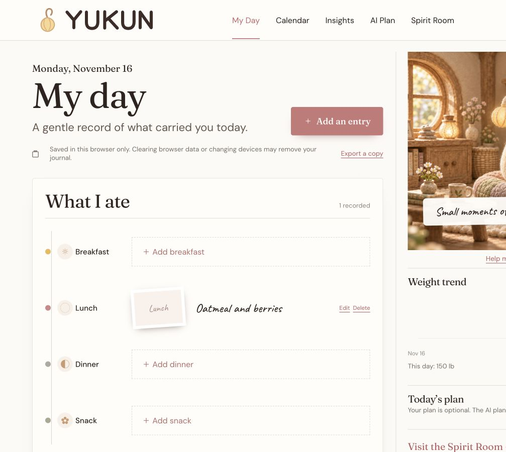

# YUKUN

A gentle, English-language journaling website for meals, movement, mood, cycle notes, and optional weight. The anonymous journal works locally; account, cloud, AI and checkout integrations are implemented behind configuration and review gates.


## What works in this preview

- Anonymous dated journal: add, edit, delete, and undo entries for meals, movement, mood, cycle, and notes.
- One optional weight value per day, with a chart of recorded points and neutral calendar and Insights views.
- Meal photo stickers. Users write their own food names and may enter calories manually; the app does not identify food or estimate calories.
- Companion room, naming, and Light Seeds earned from qualifying journal activity.
- Structured “Help me pause” choices and a JSON export of local records and photos.
- Responsive desktop and mobile browser layouts.
- Optional email account and separate cloud journal once Supabase is configured. An explicit action copies the local journal; signing in alone never migrates it.
- Server routes for a reviewed, adult-only AI plan and one-time Stripe Checkout. These remain unavailable until their external services and approvals are configured.



**Preview boundary:** Anonymous records and photos are stored in the visitor’s browser with IndexedDB. Clearing site data or switching devices can remove them. With Supabase configured, a signed-in person may choose a separate cloud journal; the local copy is never deleted automatically. There is no youth journal or clinical service. The private journal in this development preview requires an adult self-declaration; this is not a production age-verification system.

## Run locally

Requires Node.js 22.12 or later.

```bash
npm ci
npm run dev
```

Run the quality checks:

```bash
npm run lint
npm test
npm run build
```

`npm run build` type-checks browser and server code and writes the browser site to `dist/`. Vite's local server does not run the `/api` Vercel Functions. To exercise server routes locally, use a configured Vercel project and `vercel dev`.

## Deploy to Vercel

Import this repository as a Vercel project. Use the repository root as the project root. Vercel can detect Vite; the build command is `npm run build` and the output directory is `dist`. No environment variables are needed for anonymous journaling. `vercel.json` rewrites browser deep links to the app entry point. The `api/` directory contains server functions.

### Services setup

1. Create a Supabase project. Run `supabase/migrations/202611160001_services.sql` in its SQL editor. Check that journal rows and private photos are isolated by user with two test accounts before accepting real data.
2. In Supabase Auth, enable email sign-in, configure the deployed Site URL and redirect URLs, and decide the confirmation and recovery email policy. Copy the project URL and **publishable** key to `VITE_SUPABASE_URL`, `VITE_SUPABASE_PUBLISHABLE_KEY`, `SUPABASE_URL`, and `SUPABASE_PUBLISHABLE_KEY` in Vercel. Put the **service role** key only in Vercel's server environment as `SUPABASE_SERVICE_ROLE_KEY`.
3. For AI, set `OPENAI_API_KEY` and `OPENAI_MODEL` in Vercel. Keep `AI_CLINICAL_APPROVED=false` until the age/health eligibility rules, prompt, output, privacy notice and plan content have been reviewed by qualified clinicians and a registered dietitian. The API sends only the submitted goal and routine after eligibility checks; it does not send the journal.
4. For payment, create one active **one-time USD** Stripe Price for Complete Collection. Set `STRIPE_SECRET_KEY`, `STRIPE_COMPLETE_COLLECTION_PRICE_ID`, `SITE_URL`, and a webhook endpoint at `/api/stripe-webhook` subscribed to `checkout.session.completed` and `checkout.session.async_payment_succeeded`. Set its signing secret as `STRIPE_WEBHOOK_SECRET`. Keep `PAYMENTS_APPROVED=false` until price, tax, refund, privacy, minor purchase policy, and actual wardrobe entitlement behavior are ready. A return from Checkout alone never grants access; only the verified paid webhook does.
5. Deploy a private test environment and use two separate accounts to verify isolation, browser-to-cloud copy (including photos), stale-save conflict, AI exclusion, a Stripe test-mode purchase, webhook retry, and account recovery. Do not place any secret in a `VITE_` variable, GitHub, screenshots, or chat.

The variable names are listed in `.env.example` without values. The current public site still says `noindex, nofollow`; removing that and launching to the public requires privacy, clinical, legal, security and payment review. The cloud schema is a small initial snapshot design capped at 1 MB of JSON plus separate private photos; large journals will need a paged record model before scale.

This preview is marked `noindex, nofollow`. Keep it labelled as a preview when sharing it. Before opening a public health product, the planned account, AI, youth, privacy, clinical, and payment flows need their own implementation and review.

## Engineering notes

- React 19, TypeScript, Vite, IndexedDB, Supabase, Vercel Functions, OpenAI Responses, Stripe, Vitest, and GitHub Actions CI.
- `src/domain.ts` owns journal invariants and Light Seed rules; `src/storage.ts` owns local persistence and export; `src/cloud.ts` owns explicit cloud copy and revisioned saves.
- Anonymous journal data is not sent to a server. A signed-in cloud copy uploads only after the person chooses it; AI answers are sent only on a separate Generate action.
- Source code and the generated visual assets in `public/assets/` are versioned here. Demo entries in screenshots are examples, not user data.
